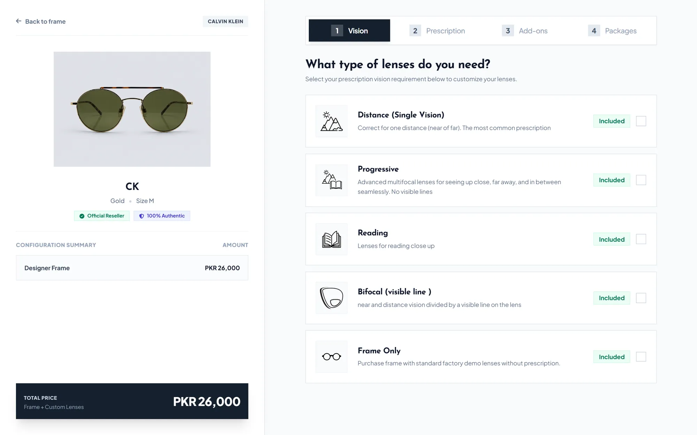
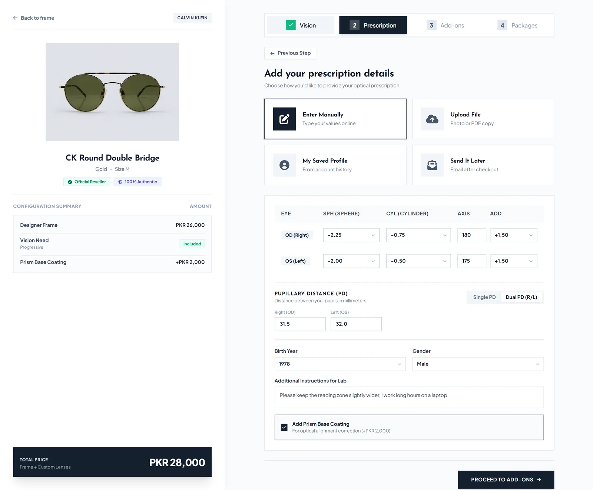
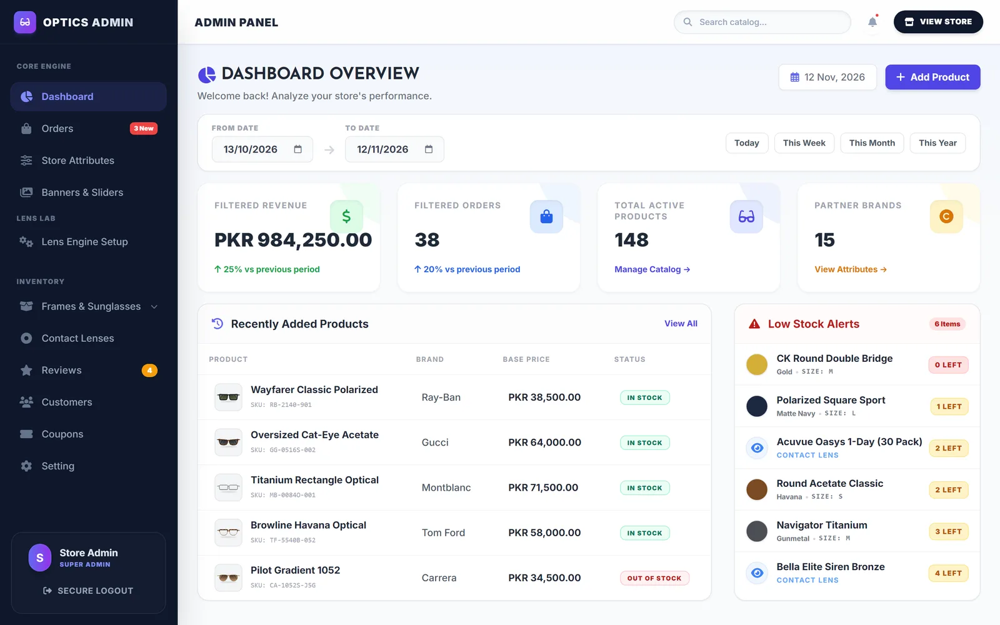
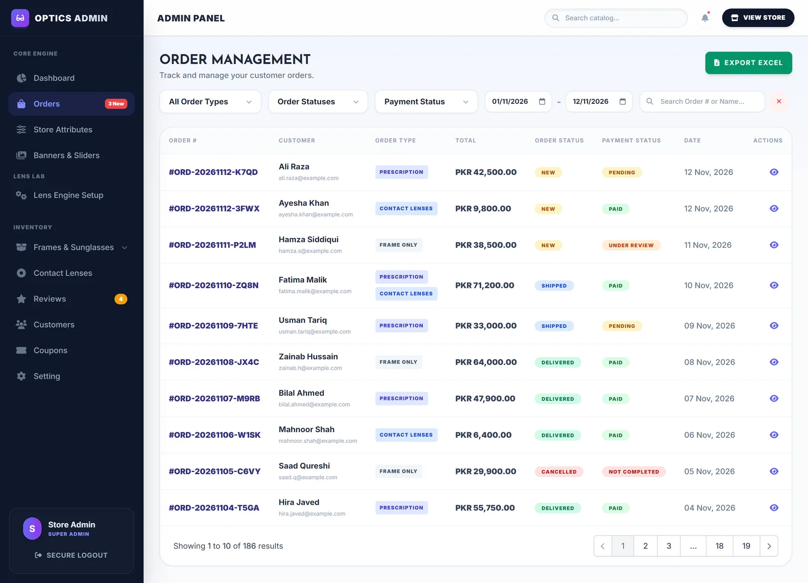
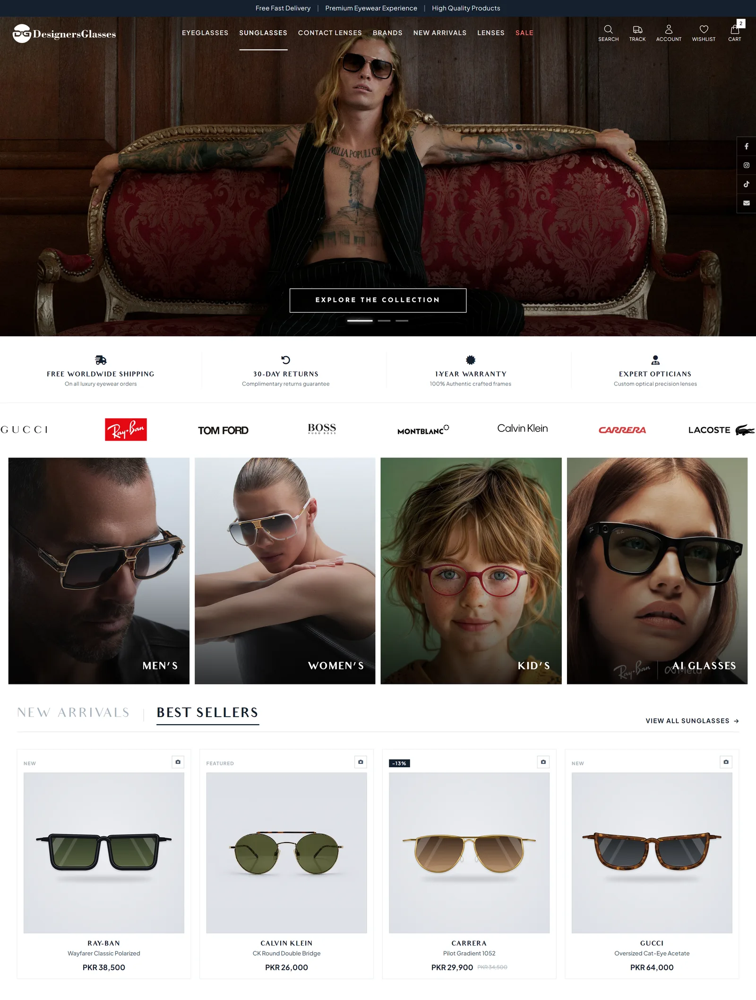
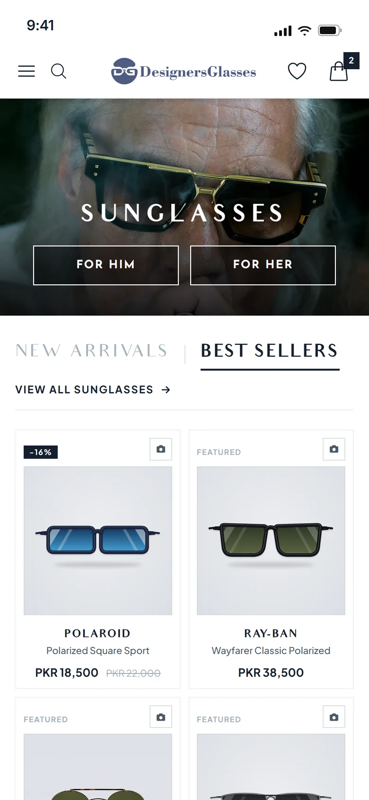

# Designers Glasses: Eyewear E-Commerce and Store ERP

An online eyewear store with a step-by-step prescription lens configurator, a contact lens shop and a full admin back office, built with Laravel and Livewire.

**Live store:** [www.designersglasses.com](https://www.designersglasses.com) · **Case study:** [farhadnazir.com/projects/designers-glasses](https://farhadnazir.com/projects/designers-glasses/)

The lens configurator on the live store (step 1: vision type).

> [!NOTE]
> This repository is a **public overview** of the project. The production source code is private because this is a client project, so there is no code or setup guide here.

## About

Designers Glasses is a live online eyewear store in Pakistan. It sells designer frames, sunglasses, AI glasses and contact lenses, with prices in PKR. Customers can buy a frame on its own or add prescription lenses, configured step by step in the browser.

I built the whole platform on my own as the sole full-stack developer, through [Techwine Solutions](https://www.techwinesolutions.com): database design, storefront, admin back office, payment integrations, deployment and client documentation. The production codebase has 152 commits from April to October 2026.

**Why it needed a custom build:** one prescription eyewear order combines a frame variant with a vision type, a prescription (SPH, CYL, axis, ADD, PD and sometimes prism), a lens package and coatings or tints. All of these affect the price, and some options only work with others. Contact lenses add power, base curve and diameter per eye, sold by the box. Off-the-shelf store builders do not model this.

## Key features

### Storefront

- **Four-step lens configurator.** Vision type, prescription, add-ons and lens package, with a live configuration summary and running total. Frame Only goes straight to the cart and Non-Prescription skips the prescription step.
- **Flexible prescription entry.** Type the prescription (both eyes, single or dual PD, optional prism at an extra charge), upload a prescription file, or reuse the prescription saved in the customer's account.
- **High-prescription filtering.** At SPH 4.00 or CYL 2.00 or more (plus or minus) in either eye, only packages marked as suitable for high prescriptions (thinner high-index lenses) are offered.
- **Contact lens shop with volume pricing.** Per-eye power, base curve and diameter, a same-for-both-eyes option, box quantities and lens colors. Tier pricing applies automatically based on the total number of boxes.
- **Catalog filters synced to the URL.** Gender, brand, category, frame shape, style, material, face shape, color, size, price and width, plus search and sorting. Filtered results can be shared and bookmarked.
- **Customer accounts.** Order history, saved prescription, profile, wishlist and downloadable PDF invoices. Order confirmations are sent by email.
- **Checkout.** Cash on Delivery and PayPal, with coupons. An HBLPay card checkout integration sits behind a configuration switch.

### Admin back office (store ERP)

- **Lens Engine.** Staff manage vision types, lens packages (index, thickness, branded and non-branded), add-on groups, add-ons and colors, a pricing matrix per vision type with auto-fill, and package compatibility rules. Lens options and prices live in the database, not in code.
- **Variant-level inventory.** Stock is deducted per frame color and size at checkout, and the dashboard shows low-stock alerts across variants and base products.
- **Analytics.** Revenue and order totals for any date range, compared with the previous period of the same length.
- **Order management.** Filter by order type, status, payment status and date, open each order with its full prescription and lens choices, and export to Excel.
- **Verified-buyer reviews.** Only customers who bought a product can review it. Reviews go through an approval queue, and a scheduled Artisan command auto-approves reviews pending for more than 24 hours.
- **Store management.** Catalog and variants, customers, coupons, banners and store settings, with Excel exports for orders, customers and products.

## Screenshots

Images captioned *Recreated from the app's source code with demo data* are not captures of the live store and show no real customers or orders.

| | |
|:---:|:---:|
|  |  |
| Live store home page and main navigation. | Configurator step 2: manual prescription, dual PD and live price summary. Recreated from the app's source code with demo data. |
|  |  |
| Admin dashboard: date-filtered KPIs, recent products and low-stock alerts. Recreated from the app's source code with demo data. | Order management with filters, order type badges and Excel export. Recreated from the app's source code with demo data. |
|  |  |
| Storefront home: hero, brand strip, category tiles and Best Sellers. Recreated from the app's source code with demo data. | Mobile storefront with the Best Sellers grid. Recreated from the app's source code with demo data. |

## Tech stack

| Area | Technology |
|---|---|
| Backend | Laravel 12, PHP 8.2 |
| Front end | Livewire 3, Blade, Tailwind CSS, Alpine.js, Vite |
| Database | MySQL |
| Auth | Laravel Breeze (email verification, role-based admin middleware) |
| Payments | Cash on Delivery, PayPal JS SDK, HBLPay (behind a configuration switch) |
| Documents | DomPDF (invoices), Laravel Excel (exports) |

## Architecture

The platform is a single Laravel application. The storefront and the admin panel are both built from Livewire 3 components (37 in total, most of them full pages), which gives an app-like feel without a separate JavaScript front end. Data lives in MySQL across 56 migrations and 32 Eloquent models.

- **Data-driven lens pricing.** Lens options are modeled as related tables (vision usages, packages, add-on groups, add-ons, colors, a per-usage pricing matrix and compatibility rules), so the store can change its lens offer and prices without a developer.
- **Rule-based configurator flow.** The configurator decides which steps to show from the selected vision type, validates the prescription and narrows the lens packages for high prescriptions.
- **Prescription stored with each order.** Each order item keeps the full prescription and lens choices as structured data, so staff have everything needed to fulfil the order in one place.
- **Encrypted card gateway integration.** The HBLPay integration encrypts each order payload with a fresh AES key, RSA-encrypts the credentials and key, decrypts the return payload and maps response codes to order status.
- **Reusable Excel export.** One export class and button component exports any model with a date range, filters and optional joins.
- **Auth and roles.** A role column and admin middleware protect the back office, and customers and staff are redirected to their own areas after login.

## Links

- Live store: [www.designersglasses.com](https://www.designersglasses.com)
- Case study: [farhadnazir.com/projects/designers-glasses](https://farhadnazir.com/projects/designers-glasses/)
- More projects: [farhadnazir.com/projects](https://farhadnazir.com/projects/)

## Author

**Farhad Nazir**, full-stack software developer and founder of [Techwine Solutions](https://www.techwinesolutions.com)

- Website: [farhadnazir.com](https://farhadnazir.com)
- Email: [farhadnazirksa@gmail.com](mailto:farhadnazirksa@gmail.com)
- LinkedIn: [linkedin.com/in/farhadnazir](https://www.linkedin.com/in/farhadnazir)
- WhatsApp: [+966 53 656 6380](https://wa.me/966536566380)

Need a store or ERP like this? [Get in touch](https://farhadnazir.com/contact/).

Also by me: [Asaan Optics](https://github.com/farhadnazir/Asaan-Optics-App-Official), POS and shop management software for optical shops.

## License

Proprietary. This repository contains documentation and screenshots only. The store name and brand belong to their owner.
