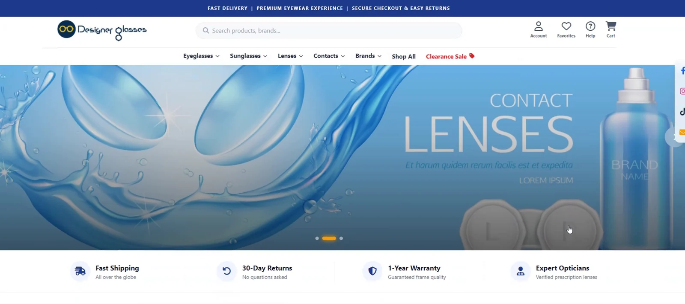
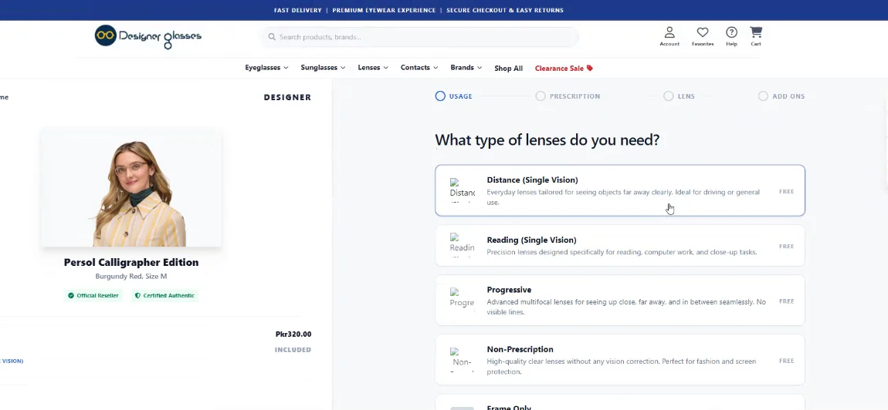
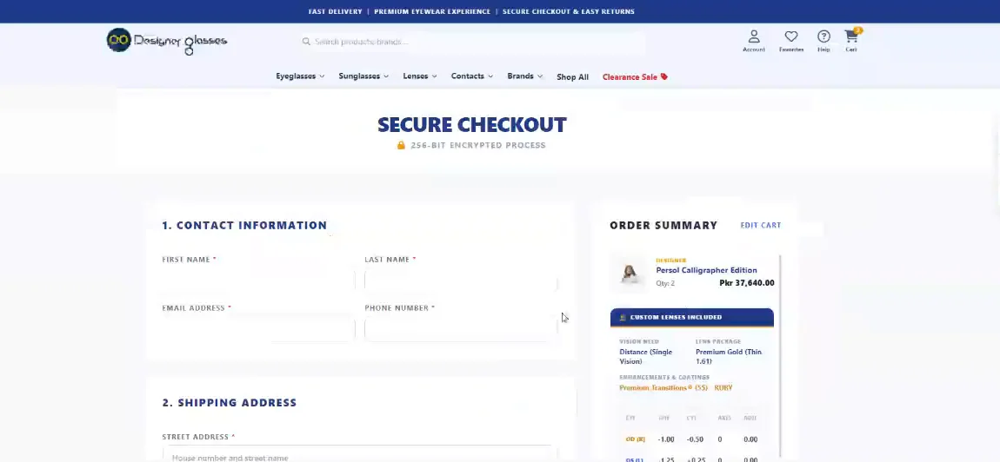
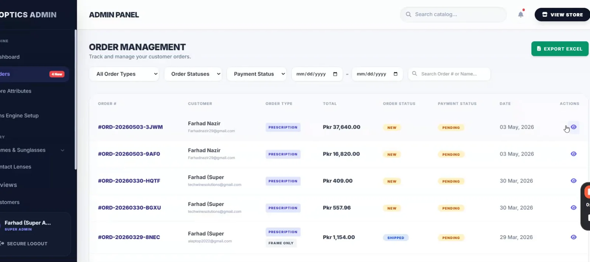
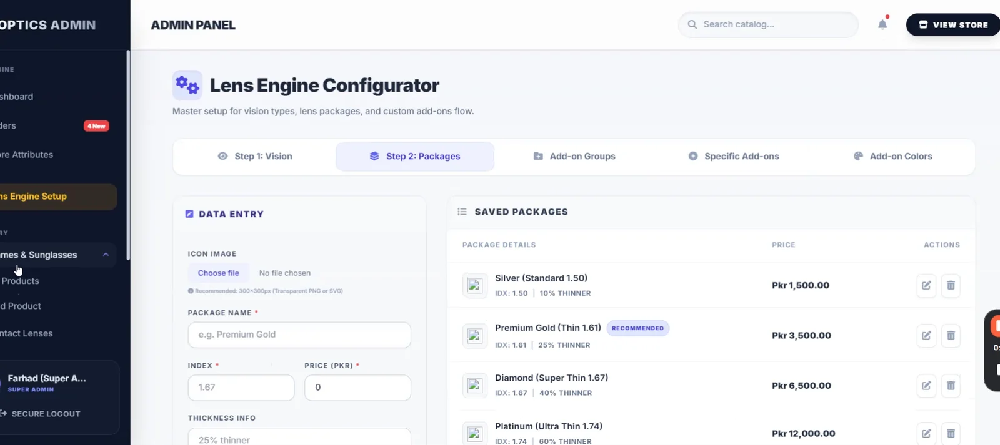
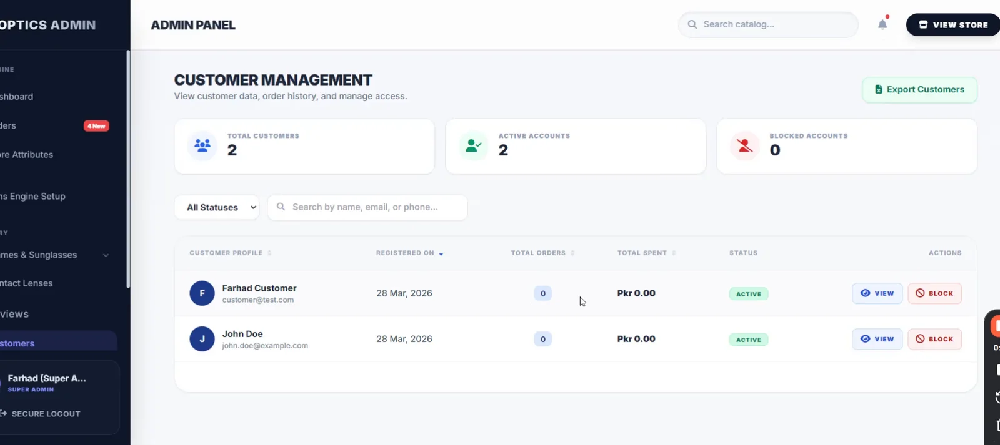

# 👓 Next-Gen Eyewear E-Commerce & ERP


Next-Gen Eyewear is a bespoke, enterprise-grade E-commerce and Inventory Management System engineered specifically for the optical industry. It seamlessly bridges the gap between complex optical prescriptions (frames, contact lenses, Rx) and a modern, high-converting retail experience.

Built with performance and scalability in mind, it replaces traditional disjointed tools with a unified platform for inventory sync, financial analytics, and customer relationship management.

---

## ✨ Highlighted Features

### 🛍️ Smart Optics Catalog & Cart
* **Complex Product Typology:** Distinct engines for Standard Frames, Sunglasses, and Contact Lenses.
* **The Lens Engine:** Handles dynamic optical parameters (SPH, SPH-CYL, Base Curve, Diameter) natively within the cart.
* **Volume Pricing:** Automated tier-based discounts for contact lenses (e.g., "Buy 4+ Boxes, Save 10%").
* **Advanced Filtering:** Filter catalog by face shape, frame material, gender, and color variants.

### 📦 Intelligent Inventory & ERP
* **Variant-Level Syncing:** Real-time stock deduction on checkout and automated restocking on order cancellation.
* **Low Stock Alerts:** Smart dashboard widget that detects low inventory across base products AND specific color/size variants.
* **Prescription (Rx) Vault:** Customers can upload or manually input optical prescriptions, securely saved to their profile.

### 📊 Financial Intelligence & Moderation
* **Admin Command Center:** Real-time analytics, MoM (Month-over-Month) revenue growth, and active order tracking.
* **Verified Review Engine:** Strict "Buyers Only" review policy with a moderation queue (Approve/Reject) and dynamic star-rating distribution charts.
* **Automated Invoicing:** Auto-generated PDF receipts upon order completion.

---

## 💻 Tech Stack & Development Journey

**Development Timeline:** Architected and deployed within a rapid, focused development cycle.
**Core Philosophy:** the feel of an SPA (Single Page Application) without the overhead of a separate JS framework, achieved through Livewire.

* **Backend Framework:** Laravel 11/12
* **Frontend Reactive Engine:** Livewire 3
* **Styling & UI:** Tailwind CSS, FontAwesome, Alpine.js
* **Database:** MySQL (Relational architecture for complex variants)
* **Authentication:** Laravel Breeze

---


## 📸 Platform Gallery

### 🛍️ Storefront & Lens Engine
<p align="center">
  
</p>
<p align="center">
  
  
</p>

### 📊 Admin Command Center
<p align="center">
  
  
</p>
<p align="center">
  
</p>

### 🎥 Video Walkthroughs

**Customer view**

https://github.com/user-attachments/assets/ee7cd333-716a-4c4d-b475-13e6ec0757de

**Admin command center**

https://github.com/user-attachments/assets/06a015f5-d47e-475d-8848-d0a578f83a58

**Contact lens & lens engine**

https://github.com/user-attachments/assets/7459287c-3b2d-4fb1-b8d7-f833fd4d9887

---

## 🗄️ Core Database Schema

The architecture is highly relational to support the optical business logic:

* `users`: Core authentication and role management (Admin/Customer).
* `products`: Base product information, type (Frame/Lens), and base pricing.
* `product_variants`: Handles colors, size categories, and variant-specific stock levels.
* `contact_lens_details`: specialized table for SPH limits, BC, DIA, and JSON volume pricing.
* `orders` & `order_items`: Financial transactions and cart history.
* `product_reviews`: Verified buyer ratings, linked to `users` and `products` with status toggles.

---

## 📂 Project Architecture (Livewire Approach)

The application relies heavily on component-based architecture for real-time reactivity without page reloads:

```text
app/Livewire/
├── Admin/
│   ├── Dashboard.php              # Analytics & Low Stock Logic
│   ├── ProductManager.php         # Base CRUD
│   ├── ProductVariantManager.php  # Variant Engine
│   ├── ContactLensManager.php     # Rx & Volume Configurator
│   └── ReviewManagement.php       # Moderation Queue
└── Frontend/
    ├── ProductCatalog.php         # Advanced Filtering
    ├── ContactLensShopper.php     # Rx Input & Tiered Pricing Cart
    ├── CheckoutPage.php           # Secure Checkout & Stock Deduct
    └── ProductReviews.php         # Star Distribution & Submission
```

## 🛡️ License & Contact

This project is proprietary, developed as a complete solution for the optical retail sector.

**Developed by:** Farhad Nazir, Full-Stack Developer (Laravel / Flutter), Founder @ Techwine Solutions

* 💼 **LinkedIn:** [linkedin.com/in/farhadnazir](https://www.linkedin.com/in/farhadnazir)
* 🌐 **GitHub:** [github.com/farhadnazir](https://github.com/farhadnazir)
* 📫 **Email:** farhadnazir1111@gmail.com

> Also by me: [**Asaan Optics**](https://github.com/farhadnazir/Asaan-Optics-App-Official), POS and shop management for optical shops on Android, Windows and iPhone/iPad.
